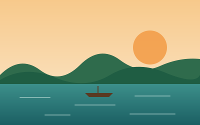

# MDD Explora: documentación completa del proyecto

> Proyecto Final Integrador · Desarrollo Web I · Universidad Nacional Amazónica de Madre de Dios (UNAMAD)
> Puerto Maldonado, Perú · 2026

---

## Índice

1. [Datos generales](#1-datos-generales)
2. [Historia del proyecto](#2-historia-del-proyecto)
3. [Requisitos del profesor](#3-requisitos-del-profesor)
4. [Análisis del negocio (resumen del Word)](#4-análisis-del-negocio-resumen-del-word)
5. [La web: qué se construyó](#5-la-web-qué-se-construyó)
6. [Responsive Web Design aplicado](#6-responsive-web-design-aplicado)
7. [Metodologías CSS3: OOCSS + BEM](#7-metodologías-css3-oocss--bem)
8. [Estructura de archivos](#8-estructura-de-archivos)
9. [Catálogo de servicios (datos simulados)](#9-catálogo-de-servicios-datos-simulados)
10. [JavaScript: funcionalidades](#10-javascript-funcionalidades)
11. [Pruebas realizadas](#11-pruebas-realizadas)
12. [Repositorio git](#12-repositorio-git)
13. [Cómo ejecutar y publicar](#13-cómo-ejecutar-y-publicar)
14. [Pendientes y próximos pasos](#14-pendientes-y-próximos-pasos)
15. [Guion breve para exponer la web](#15-guion-breve-para-exponer-la-web)

---

## 1. Datos generales

| Campo | Detalle |
| --- | --- |
| **Proyecto** | MDD Explora |
| **Descripción** | Plataforma web para la promoción y gestión de servicios de turismo sostenible en la región de Madre de Dios |
| **Empresa desarrolladora** | Amazonía Digital S.A.C. (empresa simulada, conformada por el equipo) |
| **Universidad** | Universidad Nacional Amazónica de Madre de Dios (UNAMAD) |
| **Curso** | Desarrollo Web I (en el Word figura como "Desarrollo de Aplicaciones Web") |
| **Empresas caso de estudio** | Expediciones Garza Real, Lodge Castaña Azul y Botes Martín Pescador (simuladas) |
| **Carpeta del proyecto** | `Documentos\mdd-explora` |

### Integrantes

- Alexzandro Edison Diaz Condori
- Luis Emanuel Willian Soplin Jimenez
- Elias Benjamin Lara Mercado

---

## 2. Historia del proyecto

### Etapa 1: chat "Tema de presentación para desarrollo web" (claude.ai, septiembre 2026)

En ese chat se elaboraron los dos entregables de la parte de análisis del negocio:

1. **Presentación `MDD_Explora_Caso_Empresa.pptx`**
   - 15 diapositivas, unos 9 minutos de exposición, con notas del orador.
   - Se agregaron diapositivas sobre los negocios que solo usan WhatsApp y Facebook y sus 6 problemas: mensajes sin responder, información desordenada, reservas en cuaderno, no aparecen en Google, dependen de intermediarios y no tienen datos de su negocio.
   - Se definieron las 3 empresas caso como las primeras afiliadas, con una nota de que son "casos ilustrativos con nombres ficticios". Al exponer, hay que presentarlas como "casos típicos", no como empresas reales con las que se conversó.
   - Se quitó la diapositiva de agenda para no pasar de 10 minutos.
2. **Documento `MDD_Explora_Proyecto_Final_Integrador.docx`**
   - 7 páginas (portada + 6 de contenido), siguiendo los puntos 1.1 a 1.4 del esquema del curso.
   - El PPT se actualizó para que coincida con el Word: "Amazonía Digital S.A.C." y los nombres de los integrantes en la portada.

Ambos archivos se descargaron en `Descargas\files.zip`.

### Etapa 2: indicaciones del profesor (WhatsApp)

El profesor escribió al grupo:

> En el aula virtual están las presentaciones. En ese sentido, su proyecto debe tomar en cuenta ello. Responsive Design y utilizar cualquiera de las metodologías CSS3… no olvidarse. Tomaré en cuenta ello… y sobre todo el repositorio.

Las presentaciones que menciona son:

- `S9ResponsiveWebDesing.pdf` (33 diapositivas): Responsive Web Design, Mobile First y Desktop First, media queries, breakpoints, viewport, `border-radius` y `box-shadow`.
- `S20MetodologiasCSS.pdf` (30 diapositivas): OOCSS, BEM, arquitectura modular de carpetas y preprocesadores.

### Etapa 3: construcción de la web (Claude Code, 9 de octubre de 2026)

Se decidió:

- **Construir la web** (no solo actualizar los documentos).
- Usar como metodología **BEM + OOCSS**, que es justo lo que enseñó el profesor en la semana 20.

Resultado: sitio de 3 páginas, responsive, con arquitectura CSS modular, documentado en un `README.md` y guardado en un repositorio git local con su primer commit.

---

## 3. Requisitos del profesor

Cómo cumple la web cada requisito:

| Requisito | Cómo se cumple | Dónde verlo |
| --- | --- | --- |
| **Responsive Design** | Enfoque Mobile First con breakpoints en 600, 1024 y 1440px, rejillas fluidas, imágenes fluidas y unidades relativas | `css/layout/_grid.css`, media queries en cada módulo |
| **Metodología CSS3** | OOCSS (estructura separada de la piel, Media Object) + BEM (`bloque__elemento--modificador`) | Todas las clases del HTML, carpeta `css/` |
| **Arquitectura modular** (diapositiva de la S20) | Carpetas `base/`, `layout/`, `modules/`, `themes/` y `utilities/` | `css/main.css` |
| **Propiedades CSS3** (S9) | `border-radius`, `box-shadow`, gradientes, `transition`, `transform`, variables CSS | `css/themes/_amazonia.css`, `css/modules/` |
| **Viewport** (S9) | `<meta name="viewport" content="width=device-width, initial-scale=1">` | Las 3 páginas HTML |
| **Repositorio** | Repositorio git con commit inicial y `README.md` que explica todo | Carpeta `.git`, `README.md` |

---

## 4. Análisis del negocio (resumen del Word)

### 4.1 Contexto

- **Tipo de empresa:** tres MYPE turísticas simuladas de Puerto Maldonado, primeras afiliadas a la plataforma. A futuro se afiliarán más operadores.

| Empresa | Rubro | Situación actual |
| --- | --- | --- |
| Expediciones Garza Real | Agencia de tours (Lago Sandoval) | Atiende por WhatsApp y una página de Facebook |
| Lodge Castaña Azul | Hospedaje (río Tambopata) | Atiende por WhatsApp y llamadas; registra reservas en cuaderno |
| Botes Martín Pescador | Transporte fluvial y guiado | Solo WhatsApp y recomendaciones de hoteles |

- **Sector:** terciario (servicios), turismo, ecoturismo y turismo de naturaleza. Amazonía Digital S.A.C. pertenece al subsector de TI aplicadas al turismo.
- **Problema:** la oferta turística está dispersa entre redes sociales, agencias y recomendaciones. Las MYPE no tienen web y el turista, sobre todo el extranjero, no las encuentra.
- **Justificación:** el turista planifica desde el celular. Una web responsiva centraliza la información, está disponible 24 horas, recibe reservas sin depender del chat y genera datos. WhatsApp no se elimina: se integra como canal de contacto.

### 4.2 Análisis del problema

- **Turista:** busca en muchas fuentes, no ve precios ni disponibilidad, espera respuesta por WhatsApp y no sabe combinar tour, hospedaje y transporte.
- **Operador:** mensajes sin responder fuera de horario o sin señal en el río, información desordenada, reservas en cuaderno con riesgo de dobles reservas, invisible en buscadores, dependiente de intermediarios y sin datos de ventas.
- **Casos concretos:**
  - Garza Real pierde clientes por responder tarde los mensajes nocturnos.
  - Castaña Azul tuvo dos grupos reservados para las mismas habitaciones.
  - Martín Pescador depende de que un hotel lo recomiende.

**Impacto (fuentes: Mincetur):**

- Unos **437 mil visitantes** a los principales atractivos en 2023, el 86,3% nacionales (Mincetur, 2024a).
- El turismo interno hacia Madre de Dios creció **87,8%** en el primer semestre de 2024 (Mincetur, 2024b).
- Unos **350 establecimientos de hospedaje** en la región (Mincetur, 2024a).

**FODA resumido:**

| Fortalezas | Oportunidades |
| --- | --- |
| Biodiversidad única (Tambopata, Sandoval, Valencia); equipo que conoce la realidad local; tecnologías web libres y baratas | Turismo interno en fuerte crecimiento; uso masivo del celular; pocos operadores con web propia |
| **Debilidades** | **Amenazas** |
| Equipo sin experiencia comercial; presupuesto limitado; dependencia de que los operadores actualicen datos | TripAdvisor y Booking; conectividad limitada en zonas rurales; informalidad y estacionalidad por lluvias |

**Stakeholders:** turistas, operadores turísticos, administrador (Amazonía Digital S.A.C.), DIRCETUR/Gobierno Regional, SERNANP, comunidades nativas, transportistas fluviales y UNAMAD.

### 4.3 Propuesta de valor

- **Solución:** plataforma web responsiva que conecta turistas con atractivos, guías, hospedajes, restaurantes, transporte fluvial y experiencias culturales. Tiene 9 módulos: usuarios y roles, destinos, servicios, paquetes, reservas, comentarios y calificaciones, mapa interactivo, notificaciones, y reportes.
- **Ejemplo de uso:** "quiero una experiencia de naturaleza de dos días con S/ 300" → tour al Lago Sandoval (Garza Real) + noche en Lodge Castaña Azul + traslado con Botes Martín Pescador. **Este ejemplo está implementado en la web** (ver sección 10).
- **Diferenciación:** información local centralizada, incluye guías y emprendimientos pequeños, reserva en línea, paquete según presupuesto, mapa de rutas locales y comisión baja.
- **Beneficios:**
  - Operativos: un solo panel y sin dobles reservas.
  - Financieros: más reservas y menos pago a intermediarios.
  - Estratégicos: datos de demanda y escalabilidad.

### 4.4 Modelo de negocio

- **Fuentes de ingresos:** comisión por reserva confirmada (5–8%), plan "destacado" mensual y publicidad de negocios locales. El plan "destacado" **se ve en la web** con la etiqueta *Destacado* y el borde naranja de las tarjetas.
- **Canales:** web responsiva (móvil y PC), redes sociales y códigos QR en hoteles y aeropuerto.
- **Procesos digitalizados:**
  1. Registro de operadores
  2. Publicación de servicios
  3. Búsqueda y reserva
  4. Confirmación
  5. Reseñas
  6. Reportes

**KPIs:**

| Indicador | Meta (1.er año) |
| --- | --- |
| Tiempo de respuesta a una reserva | Menos de 24 h |
| Operadores validados | 30+ en 6 meses |
| Conversión de visitas a reservas | ≥ 3% |
| Calificación promedio | ≥ 4,0 / 5 |
| Reservas mensuales | +20% vs. mes anterior |
| Operadores con disponibilidad al día | 90% |

**Alcance:**

- **Fase 1:** piloto con las 3 empresas en Puerto Maldonado y Tambopata (Reserva Nacional Tambopata, Lago Sandoval y Lago Valencia).
- **Fase 2:** más operadores, Manu y Tahuamanu, y pagos en línea.

---

## 5. La web: qué se construyó

### 5.1 Páginas

#### `index.html` (inicio)

| Sección | Contenido |
| --- | --- |
| Cabecera | Logo, menú (hamburguesa en móvil, horizontal en PC) y botón "Reservar" |
| Hero | Título "Toda la Amazonía de Madre de Dios en un solo lugar", botones y 3 cifras de Mincetur |
| Planificador | Formulario días + presupuesto + personas que arma un paquete automáticamente |
| Destinos | Tarjetas de Lago Sandoval, Reserva Nacional Tambopata y Lago Valencia |
| Operadores | Las 3 empresas con su situación "antes" y "ahora" (Media Object de OOCSS) |
| Mapa | Mapa interactivo con Leaflet + OpenStreetMap y 4 lugares clicables |
| Cómo funciona | Los 4 pasos del proceso TO-BE: busca, compara, reserva y recibe confirmación |
| Reseñas | 3 reseñas de ejemplo (marcadas como demostración) |
| Llamado a la acción | Invitación a nuevos operadores para afiliarse |
| Pie de página | Empresa, enlaces, operadores e integrantes del equipo |

#### `servicios.html` (catálogo)

- Buscador por texto (nombre, descripción o empresa).
- Filtros por tipo: Todos, Tours, Hospedaje y Transporte.
- Orden por relevancia, precio (menor o mayor) o mejor calificación.
- Contador de resultados.
- Tarjetas con imagen, tipo, empresa, descripción, duración, calificación, precio y botón "Reservar".
- Acepta filtros desde la URL, por ejemplo `servicios.html?tipo=tour`.

#### `reservar.html` (reserva)

- Paso 1: selección de uno o varios servicios (casillas).
- Paso 2: fecha (mínimo mañana) y número de personas.
- Paso 3: nombre, correo, WhatsApp y comentarios.
- Resumen lateral con el total calculado en vivo (fijo en pantalla en PC).
- Validación: muestra qué campos faltan.
- Al enviar, muestra un código de reserva (ej. `MDD-4F2K9A`) y a qué empresas se envió la solicitud.
- Se puede llegar con servicios ya marcados desde el planificador o el catálogo: `reservar.html?servicios=tour-sandoval,noche-bungalow&personas=2`.

> **Importante:** es una demostración de frontend. Los datos del formulario **no se envían a ningún servidor**. Así lo dice la propia página.

### 5.2 Diseño visual

| Elemento | Valor |
| --- | --- |
| Verde selva (principal) | `#1f5d43` |
| Turquesa río | `#1b7f8c` |
| Naranja guacamayo (acentos y botones) | `#e0702e` |
| Arena (fondo) | `#f7f2e8` |
| Tipografía de títulos | Fraunces (Google Fonts) |
| Tipografía de texto | Inter (Google Fonts) |
| Imágenes | Ilustraciones SVG propias (lago, selva con guacamayo, lodge y río con bote) y logo |

---

## 6. Responsive Web Design aplicado

### 6.1 Enfoque: Mobile First

Según la S9, Mobile First (Luke Wroblewski, 2011) obliga a priorizar el contenido. Los estilos base son para el celular, y con `@media (min-width: …)` se **añade** complejidad cuando la pantalla crece.

### 6.2 Breakpoints

Se basan en la tabla de la diapositiva "Media queries y breakpoints estratégicos":

| Breakpoint | Dispositivo | Qué cambia en la web |
| --- | --- | --- |
| Base (< 600px) | Móviles | Una columna, menú hamburguesa, botones de 44px de alto (táctiles), cifras del hero en 3 columnas pequeñas |
| `min-width: 600px` | Tablets | Rejillas de 2 columnas, Media Object en fila (imagen a la izquierda), formularios en 2 columnas |
| `min-width: 1024px` | Laptops y desktops | Menú horizontal, rejillas de 3 o 4 columnas, planificador en 2 columnas, resumen de reserva fijo (sticky), mapa más alto |
| `min-width: 1440px` | Ultra-wide | El contenedor crece a `80rem` como máximo para evitar líneas de texto infinitas |

### 6.3 Técnicas usadas

- **Viewport:** `width=device-width, initial-scale=1` en todas las páginas.
- **Rejillas fluidas:** CSS Grid (`.grid`, `.grid--2`, `.grid--3`, `.grid--4`, `.grid--sidebar`) y Flexbox.
- **Imágenes fluidas:** `img { max-width: 100%; height: auto; }` (tal cual la diapositiva), además de `object-fit: cover` y `aspect-ratio`.
- **Unidades relativas:** `rem`, `%` y `vw`, y tipografía fluida con `clamp()`.
- **Propiedades CSS3:**
  - `border-radius` (tokens `--radius-sm`, `--radius-md`, `--radius-lg` y `--radius-pill`)
  - `box-shadow` (tokens `--shadow-sm`, `--shadow-md` y `--shadow-lg`)
  - `linear-gradient` y `radial-gradient`
  - `transition` y `transform` (efecto al pasar el mouse sobre tarjetas y botones)
  - variables CSS (`--color-forest`)
  - `backdrop-filter` (cabecera translúcida)
  - `:has()` (opción marcada en el formulario)
  - `counter()` (numeración de los pasos)
- **Accesibilidad:**
  - enlace "Saltar al contenido" y `aria-expanded` en el menú
  - `aria-live` en resultados y mensajes
  - foco visible
  - respeto a `prefers-reduced-motion`

---

## 7. Metodologías CSS3: OOCSS + BEM

### 7.1 OOCSS (Object-Oriented CSS, Nicole Sullivan, 2008)

**Principio 1: separar estructura y piel.**

```css
/* ESTRUCTURA: tamaño, espacio, forma */
.button {
  display: inline-flex;
  min-height: 2.75rem;
  padding: var(--space-2) var(--space-5);
  border-radius: var(--radius-pill);
}

/* PIEL: colores */
.button--primary   { background-color: var(--color-macaw);  color: var(--color-white); }
.button--secondary { background-color: var(--color-forest); color: var(--color-white); }
```

Todos los colores, sombras, radios y fuentes están como variables en `css/themes/_amazonia.css`. Si se cambia el tema, la estructura no se rompe.

**Principio 2: separar contenedor y contenido.** Una `.card` se ve igual dentro de "Destinos", del catálogo o de cualquier otro lugar.

Se siguieron las recomendaciones de la S20:

| Recomendación | Cumplimiento |
| --- | --- |
| Evitar selectores descendientes (`.sidebar h2`) | ✅ No se usan selectores de contexto |
| Evitar `id` como selectores | ✅ Los `id` solo se usan para JavaScript y anclas, nunca en el CSS |
| Evitar `div.header` | ✅ Solo clases |
| No usar `!important` | ✅ Solo dentro de `prefers-reduced-motion`, por accesibilidad |

**Objetos reutilizables:** `.container`, `.grid`, `.button`, `.badge`, `.card`, `.alert` y el **Media Object** (`.media`). Este último es el patrón que Nicole Sullivan creó para Facebook (caso de éxito de la S20) y en la web se usa para mostrar las 3 empresas.

### 7.2 BEM (Block, Element, Modifier, Yandex, 2009)

Reglas de la S20 aplicadas: solo minúsculas, elementos con `__`, modificadores con `--`, sin camelCase y sin anidar elementos (`card__image__caption` ❌).

```html
<article class="card card--featured">            <!-- bloque + modificador -->
  <div class="card__media">                       <!-- elemento -->
    
    <div class="card__badges">
      <span class="badge badge--tour">Tour</span>
      <span class="badge badge--featured">Destacado</span>
    </div>
  </div>
  <div class="card__body">
    <span class="card__company">Expediciones Garza Real</span>
    <h3 class="card__title">Tour al Lago Sandoval</h3>
    <p class="card__description">…</p>
    <div class="card__footer">
      <p class="card__price">S/ 120</p>
      <a class="button button--primary button--small" href="…">Reservar</a>
    </div>
  </div>
</article>
```

Esta tarjeta resuelve el mismo tipo de caso que el ejercicio de la S20 (tarjeta reutilizable de artesanías con imagen, título, descripción, precio, estado destacado y botón de compra), pero aplicado a servicios turísticos.

**Bloques BEM del proyecto:**

`header`, `nav`, `hero`, `section`, `section-head`, `card`, `badge`, `media`, `stat`, `planner`, `steps`, `review`, `map`, `filter`, `form`, `summary`, `alert`, `cta`, `footer`, `button`, `container` y `grid`.

**Modificadores destacados:**

| Modificador | Para qué sirve |
| --- | --- |
| `card--featured` | Servicio con plan destacado |
| `nav--open` | Estado del menú abierto en móvil |
| `hero--compact` | Portada reducida de las páginas internas |
| `section--alt`, `section--forest` | Pieles de las secciones |
| `button--primary`, `--secondary`, `--ghost`, `--light`, `--small`, `--block` | Variantes de botón |
| `badge--tour`, `--hospedaje`, `--transporte`, `--featured` | Etiquetas por tipo |
| `alert--success`, `alert--error` | Mensajes del formulario |
| `filter__chip--active`, `form__input--invalid`, `nav__link--active` | Estados de elementos |

### 7.3 Arquitectura modular

`css/main.css` importa las capas en este orden:

1. **themes:** variables de color, tipografía, espacios, radios y sombras
2. **base:** reset y estilos globales de elementos
3. **layout:** contenedor, rejilla, secciones, cabecera y pie
4. **modules:** componentes BEM
5. **utilities:** clases rápidas (`u-visually-hidden`, `u-text-center`, `u-hidden`, `u-skip-link`)

---

## 8. Estructura de archivos

```
mdd-explora/
├── index.html                  Página de inicio
├── servicios.html              Catálogo con filtros
├── reservar.html               Formulario de reserva
├── README.md                   Documentación del repositorio
├── DOCUMENTACION.md            Este documento
├── .gitignore
├── css/
│   ├── main.css                Importa todas las capas
│   ├── themes/
│   │   └── _amazonia.css       Variables (piel)
│   ├── base/
│   │   ├── _reset.css          Reset + imágenes fluidas
│   │   └── _typography.css     Fuentes, títulos, enlaces, foco
│   ├── layout/
│   │   ├── _container.css
│   │   ├── _grid.css
│   │   ├── _section.css
│   │   ├── _header.css
│   │   └── _footer.css
│   ├── modules/
│   │   ├── _alert.css     ├── _badge.css      ├── _button.css
│   │   ├── _card.css      ├── _cta.css        ├── _filter.css
│   │   ├── _form.css      ├── _hero.css       ├── _map.css
│   │   ├── _media.css     ├── _nav.css        ├── _planner.css
│   │   ├── _review.css    ├── _section-head.css
│   │   ├── _stat.css      ├── _steps.css      └── _summary.css
│   └── utilities/
│       └── _utilities.css
├── js/
│   ├── data.js                 Catálogo de servicios y empresas
│   └── main.js                 Toda la interactividad
└── img/
    ├── logo.svg
    ├── lago.svg
    ├── selva.svg
    ├── lodge.svg
    └── rio.svg
```

---

## 9. Catálogo de servicios (datos simulados)

Definidos en `js/data.js`. En la fase 2 vendrán de una base de datos.

| ID | Servicio | Empresa | Tipo | Precio | Unidad | Duración | ★ |
| --- | --- | --- | --- | --- | --- | --- | --- |
| `tour-sandoval` | Tour al Lago Sandoval ⭐ | Garza Real | Tour | S/ 120 | por persona | Día completo | 4.8 |
| `caminata-nocturna` | Caminata nocturna en la selva | Garza Real | Tour | S/ 70 | por persona | 3 horas | 4.6 |
| `collpa-guacamayos` | Collpa de guacamayos | Garza Real | Tour | S/ 160 | por persona | Madrugada + medio día | 4.9 |
| `noche-bungalow` | Noche en bungalow con desayuno ⭐ | Castaña Azul | Hospedaje | S/ 140 | por persona / noche | 1 noche | 4.7 |
| `programa-3d2n` | Programa 3D/2N todo incluido | Castaña Azul | Hospedaje | S/ 520 | por persona | 3 días / 2 noches | 4.8 |
| `traslado-fluvial` | Traslado fluvial Puerto Maldonado – lodge | Martín Pescador | Transporte | S/ 40 | por persona (ida y vuelta) | 1 h 30 min por tramo | 4.5 |
| `lago-valencia` | Paseo en bote al Lago Valencia | Martín Pescador | Transporte | S/ 180 | por persona | Día completo | 4.6 |
| `pesca-artesanal` | Pesca artesanal guiada | Martín Pescador | Tour | S/ 90 | por persona | Medio día | 4.4 |

⭐ = servicio destacado (plan "destacado").

**Ubicaciones del mapa** (coordenadas aproximadas):

| Lugar | Coordenadas |
| --- | --- |
| Puerto Maldonado | -12.5933, -69.1891 |
| Lago Sandoval | -12.6050, -69.0400 |
| Lodge Castaña Azul (referencial, río Tambopata) | -12.7400, -69.2600 |
| Lago Valencia | -12.5600, -68.8800 |

---

## 10. JavaScript: funcionalidades

Todo está en `js/main.js`, en JavaScript puro sin librerías (salvo Leaflet para el mapa). Cada función revisa si su bloque existe en la página actual antes de ejecutarse.

| Función | Página | Qué hace |
| --- | --- | --- |
| `initNav()` | Todas | Abre y cierra el menú móvil con el modificador `nav--open` y actualiza `aria-expanded` |
| `initPlanner()` / `armarPaquete()` | Inicio | Arma un paquete según días y presupuesto |
| `initMapa()` | Inicio | Crea el mapa Leaflet con marcadores; al tocar un lugar, el mapa vuela hacia él |
| `initCatalogo()` / `tarjeta()` | Servicios | Pinta las tarjetas BEM desde `data.js`, filtra, busca y ordena |
| `initReserva()` | Reservar | Genera las opciones, marca las que llegan por URL, calcula el total en vivo, valida y muestra la confirmación |
| `initAnio()` | Todas | Pone el año actual en el pie de página |

**Lógica del planificador:**

1. Si el viaje dura más de 1 día, añade el traslado fluvial y una noche de bungalow por cada noche.
2. Agrega actividades ordenadas de mejor a peor calificación, como máximo una por día, mientras alcance el presupuesto.
3. Si no alcanza para al menos una actividad, sugiere menos días o más presupuesto.
4. El botón "Reservar este paquete" lleva al formulario con todo marcado.

**Comprobación del ejemplo del Word** (2 días, S/ 300 por persona):

| Servicio | Empresa | Precio |
| --- | --- | --- |
| Traslado fluvial | Botes Martín Pescador | S/ 40 |
| Noche en bungalow | Lodge Castaña Azul | S/ 140 |
| Tour al Lago Sandoval | Expediciones Garza Real | S/ 120 |
| **Total por persona** | | **S/ 300** ✅ |

---

## 11. Pruebas realizadas

Se probó en el navegador con un servidor local:

| Prueba | Resultado |
| --- | --- |
| Vista móvil (375 × 812) | ✅ Diseño en una columna, menú hamburguesa funcionando |
| Sin barra de desplazamiento horizontal en móvil | ✅ Ancho del documento = 375px |
| Vista laptop (1366 × 850) | ✅ Menú horizontal, catálogo en 3 columnas |
| CSS cargado (todas las capas `@import`) | ✅ |
| Mapa Leaflet | ✅ Se crea correctamente |
| Planificador (2 días, S/ 300, 2 personas) | ✅ Sandoval + bungalow + traslado = S/ 300 por persona, S/ 600 en total |
| Reserva con servicios desde la URL | ✅ Marca los 3 servicios; total de S/ 600 para 2 personas |
| Validación al enviar vacío | ✅ "Falta completar: fecha, nombre, correo, WhatsApp." |

**Corrección hecha durante las pruebas:**

- El planificador decía "Te sobran S/ 0" cuando el presupuesto quedaba justo. Ahora esa frase solo aparece si sobra dinero.
- Se oscureció la parte superior de la portada para que el texto contraste mejor.

---

## 12. Repositorio git

- Rama principal: `main`.
- Primer commit: `MDD Explora: sitio responsive con OOCSS + BEM` (39 archivos).
- Autor del commit: "Alexzandro Diaz". Se puede cambiar si debe figurar otro integrante.
- `.gitignore` excluye `.DS_Store`, `Thumbs.db`, `.vscode/` y `.claude/`.
- **Aún no está subido a GitHub** (ver pendientes).

Comandos útiles:

```bash
git status
git log --oneline
```

---

## 13. Cómo ejecutar y publicar

### Ver la web en la computadora

Opción simple: doble clic en `index.html`. El mapa necesita internet para cargar.

Opción con servidor local (recomendada):

```bash
python -m http.server 5500
```

Luego abrir <http://localhost:5500>.

### Subir a GitHub

1. Crear un repositorio vacío llamado `mdd-explora` en GitHub.
2. Desde la carpeta del proyecto:

```bash
git remote add origin https://github.com/USUARIO/mdd-explora.git
```

```bash
git push -u origin main
```

3. Agregar a los otros dos integrantes como colaboradores, en **Settings → Collaborators**, para que el profesor vea los aportes de todos.

### Publicar con GitHub Pages (enlace en vivo gratis)

1. En el repositorio: **Settings → Pages**.
2. Source: rama `main`, carpeta `/ (root)`.
3. Queda en `https://USUARIO.github.io/mdd-explora/`.

---

## 14. Pendientes y próximos pasos

### Para la entrega

- [ ] Subir el repositorio a GitHub y compartir el enlace con el profesor.
- [ ] Publicar en GitHub Pages para tener un enlace en vivo.
- [ ] Que cada integrante haga al menos un commit (el profesor evaluará "sobre todo el repositorio").
- [ ] Revisar si el profesor quiere también el PDF del Word (Archivo → Guardar como → PDF).
- [ ] Agregar el nombre del docente en la portada del Word, si el formato lo exige.
- [ ] Opcional: añadir al Word y al PPT una sección sobre Responsive Design y OOCSS + BEM con capturas de la web.

### Fase 2 del proyecto (según el Word)

- Backend: Node.js con Express, PHP o Python Flask.
- Base de datos MySQL o SQL Server.
- Autenticación con sesiones o JWT, y roles (turista, operador, administrador).
- Panel del operador para gestionar disponibilidad y reservas.
- Reportes con Chart.js.
- Pagos en línea.
- Afiliación de más operadores y ampliación a Manu y Tahuamanu.

---

## 15. Guion breve para exponer la web

1. **Abrir en el celular o reducir la ventana:** "La web es Mobile First; así se ve en un teléfono". Abrir el menú hamburguesa.
2. **Agrandar la ventana:** mostrar cómo pasa a 2 columnas (600px) y luego a 3 (1024px) con el menú horizontal.
3. **Planificador:** escribir 2 días y S/ 300. "Es el ejemplo de nuestro documento: el sistema combina las 3 empresas piloto".
4. **Reservar este paquete:** mostrar el resumen con el total y la validación.
5. **Catálogo:** filtrar por "Hospedaje" y ordenar por precio.
6. **Mapa:** tocar "Lago Sandoval".
7. **Código:** abrir `css/main.css` y mostrar las carpetas `base`, `layout`, `modules`, `themes` y `utilities` (S20). Abrir `_button.css`: "estructura separada de la piel, eso es OOCSS". Mostrar una tarjeta en el HTML: "`card__title`, `card--featured`, eso es BEM".
8. **Repositorio:** mostrar GitHub con el README y los commits.

---

### Referencias

- Mincetur. (2024a). *Reporte regional de turismo: Madre de Dios, enero 2024*. Ministerio de Comercio Exterior y Turismo.
- Mincetur. (2024b). *Más de 19 millones de turistas nacionales se movilizaron por el Perú durante el primer semestre de 2024*. TV Perú.
- Marcotte, E. (2010). *Responsive Web Design*. A List Apart.
- Wroblewski, L. (2011). *Mobile First*. A Book Apart.
- Sullivan, N. (2008). *Object Oriented CSS*.
- Yandex. (2009). *BEM: Block, Element, Modifier*.
- UNAMAD, Desarrollo Web I: S9 *Responsive Web Design* y S20 *Metodologías CSS*.

> Las empresas, precios y reseñas de este proyecto son simulados con fines académicos.
